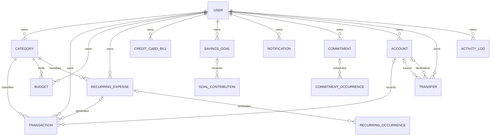

# Database schema

SQLite is accessed through SQLAlchemy. Each entity has an integer primary key `id`. User-owned records have a `user_id` foreign key; routes also enforce ownership explicitly. Foreign-key declarations describe relationships, while this beginner version relies on SQLAlchemy and application checks for deletion/tenant integrity rather than configuring SQLite foreign-key PRAGMAs or composite tenant constraints.

## `user`

| Column | Type | Purpose |
|---|---|---|
| id | Integer PK | Account identity |
| name | String(80), required | Display name |
| email | String(254), unique, required | Normalized lowercase login address |
| password_hash | String(255), required | Werkzeug salted password hash |
| currency | String(3), default INR | Display currency: INR/USD/EUR/GBP |
| session_token | String(64), unique, required | Random alternate ID for sessions and reset-token invalidation |
| failed_attempts | Integer, default 0 | Consecutive login failure counter |
| locked_until | DateTime, nullable | UTC lockout expiry |
| created_at | DateTime | Account creation in UTC |

Deleting a user through the app cascades to all their categories, transactions, budgets, recurring rules and activity logs through ORM relationships.

## `category`

| Column | Type | Purpose |
|---|---|---|
| id | Integer PK | Category identity |
| user_id | Integer FK → user.id, indexed | Owner |
| name | String(60), NOCASE | Category name |

Unique pair: `(user_id, name)`. SQLite NOCASE is case-insensitive for ASCII, not full Unicode. Deletion is blocked in the application while transactions, budgets or rules use this category.

## `transaction`

| Column | Type | Purpose |
|---|---|---|
| id | Integer PK | Transaction identity |
| user_id | Integer FK → user.id, indexed | Owner |
| category_id | Integer FK → category.id | Selected category |
| kind | String(10) | `income` or `expense` (database check) |
| amount_minor | BigInteger | Positive paise/cents; maximum 99,999,999,999 minor units |
| date | Date, indexed | Transaction's displayed calendar date |
| payment_method | String(20) | Validated payment method |
| notes | String(500) | Plain text, default empty |
| recurring_id | Integer FK → recurring_expense.id, nullable | Generating rule, if any |
| occurrence_date | Date, nullable | Original due date; remains stable if displayed date is edited |
| created_at | DateTime | Creation timestamp in UTC |

Unique pair: `(recurring_id, occurrence_date)`, protecting recurring occurrence identity. Multiple ordinary transactions can have NULL recurrence fields. Deleting a recurring rule detaches its transactions and preserves the history.

## `budget`

| Column | Type | Purpose |
|---|---|---|
| id | Integer PK | Budget identity |
| user_id | Integer FK → user.id, indexed | Owner |
| category_id | Integer FK → category.id | Limited category |
| month | Date | First day of the relevant month |
| amount_minor | BigInteger | Positive spending limit |

Unique triple: `(user_id, category_id, month)`. Spending is calculated from expense transactions in `[month, next_month)`; a redundant spent-total column is deliberately avoided.

## `recurring_expense`

| Column | Type | Purpose |
|---|---|---|
| id | Integer PK | Rule identity |
| user_id | Integer FK → user.id, indexed | Owner |
| category_id | Integer FK → category.id | Generated transaction category |
| amount_minor | BigInteger | Validated positive amount |
| payment_method | String(20) | Generated transaction payment method |
| notes | String(500) | Generated transaction notes |
| frequency | String(10) | weekly / monthly / yearly |
| next_due | Date | Next unprocessed scheduled date |
| anchor_day | Integer | Original intended day, for month-end/leap-year handling |
| active | Boolean, default true | Pause/resume flag |

Generation advances `next_due` with a conditional SQLAlchemy update and inserts its transaction in the same database transaction. Forms permit creation up to one year in the past and ten years ahead. Editing cannot rewind `next_due`.

## `credit_card_bill`

| Column | Type | Purpose |
|---|---|---|
| id | Integer PK | Bill identity |
| user_id | Integer FK → user.id, indexed | Owner |
| card_name | String(80), required | Friendly card label |
| amount_minor | BigInteger | Positive statement amount in paise/cents |
| due_date | Date, indexed | Payment due date |
| paid | Boolean | Whether the bill has been paid |
| notes | String(500) | Optional plain-text reminder |
| created_at | DateTime | Creation timestamp in UTC |

Credit card bills are reminders and are intentionally separate from transactions. Recording a bill does not create an expense transaction, preventing the statement amount from being counted twice when its underlying card transactions are already in the ledger.

## `savings_goal` and `goal_contribution`

Goals store a positive target and non-negative saved total in minor units. Contributions use signed minor units: positive values add savings and negative values record a withdrawal. The application recalculates the goal total transactionally and blocks withdrawals larger than the saved amount.

## `notification`

Notifications belong to one user and have a unique `(user_id, dedupe_key)` pair. This prevents repeated budget, bill and goal alerts while allowing the same type of alert in a later period.

## `recurring_occurrence`

Each generated recurring due date is unique per rule. Its status is `scheduled`, `paid` or `skipped`, and generated transactions retain their existing `recurring_id` relationship. This table enables calendar actions without changing historical transactions.

## `commitment` and `commitment_occurrence`

`commitment` stores generalized future obligations without turning planned payments into ledger transactions. It is user-owned and supports `loan`, `credit_card`, `subscription`, `utility`, `rent`, `insurance`, `education`, `tax`, `maintenance`, `bill`, `one_time` and `custom` types. Frequencies are `weekly`, `monthly`, `quarterly`, `yearly` and `once`; statuses are `active`, `paused` and `cancelled`. An optional payment account links a paid loan/EMI occurrence to exactly one expense transaction.

| Column | Type | Purpose |
|---|---|---|
| user_id | Integer FK → user.id, indexed | Owner |
| name | String(120), required | Friendly obligation name |
| amount_minor | BigInteger, positive | Expected installment or bill amount |
| start_date / next_due | Date | Schedule start and next expected date |
| end_date | Date, nullable | Optional schedule end |
| frequency | String(12) | Occurrence cadence |
| payment_method / autopay | String / Boolean | Payment metadata |
| reminder_days | Integer | Lead time for reminders |
| loan fields | Integer/Decimal, nullable | Principal, outstanding balance, rate, tenure and processing fee |

`commitment_occurrence` has a unique `(commitment_id, due_date)` pair. It stores expected and actual minor-unit amounts, payment date, late fee, linked transaction ID, notes and status (`scheduled`, `paid`, `partial`, `skipped`, or `missed`). This protects occurrence generation from duplicates and keeps payment history separate from the existing transaction-generation rules.

## `account`

Accounts are personal ledger locations, not bank integrations. Supported types are bank, cash, wallet, credit card, savings, current, prepaid, UPI-linked and custom. Only a display name, provider label and optional last four digits are stored; complete numbers, passwords, PINs, CVVs and OTPs are never collected.

`opening_balance_minor` is combined with assigned transaction entries to calculate the current balance. Archived accounts retain their transactions. `linked_account_id` lets a UPI or wallet label point at an existing bank account so it can be excluded from total assets and not double-count the same money.

## `transfer`

Transfers are user-owned and atomic. A transfer stores source and destination accounts, source and destination minor-unit amounts, optional fee, currencies, exchange rate, date and a unique reference. Two linked transaction entries are created with `entry_type='transfer'`; reports, budgets and insights exclude them from income and expense totals.

Balance adjustments use ordinary transaction rows with `entry_type='adjustment'`, a clear payment method and reason. They correct the calculated balance without rewriting or deleting prior history.

## `exchange_rate`

Rates are cached by unique base/quote currency pair with provider and UTC fetch timestamp. Historical transaction rows store their original currency, base amount, rate, rate date and source. Current account conversions may use the latest cached rate; if the provider is unavailable, the previous cache remains visible and is labelled cached/stale.

## `investment`

Investments are personal ledger records and never connect to brokers or execute trades. `investment_type` is configurable in `app/data/investments.py` and covers fixed deposits, recurring deposits, provident funds, bonds, mutual funds, SIPs, stocks, ETFs, NPS, gold, real estate, cryptocurrency and custom types. Each row stores the linked funding account, original currency, purchase amount, manually entered current estimate, optional maturity date, interest/dividend totals, status and a masked reference. Funding creates one `transaction` with `entry_type='investment'`, which updates the linked account balance but is excluded from ordinary income, expense, budget and insight totals.

## `activity_log`

| Column | Type | Purpose |
|---|---|---|
| id | Integer PK | Event identity |
| user_id | Integer FK → user.id, indexed | Owner |
| event | String(120) | Short event description |
| created_at | DateTime | Event time in UTC |

Contains account events, login successes/failures, record modifications, import/export and recurring processing. The profile displays the newest 100 events. Passwords, reset tokens and full financial notes are not written into this table.

## Why use minor units?

`120.50` becomes integer `12050`. Validation first parses a `Decimal`, then requires at most two decimal places. Integer addition is exact, unlike binary floating-point arithmetic. Chart.js receives major-unit numbers for display only; stored amounts and report calculations remain integers.

## Schema creation versus migration

`flask --app run init-db` uses `db.create_all()` to create absent tables. Existing installations should run `python -m flask --app run upgrade-db`; it creates the account, transfer and rate tables and adds nullable recurring-account and transaction account/currency fields with guarded `ALTER TABLE` statements. Existing transactions remain explicitly unassigned. No table is dropped or recreated. Tests build a new temporary database for each test.

### Linked ledger additions (2026-10-31)

Transaction.parent_id links split child entries to an archived split_parent. Transaction.refund_of_id links a refund to its original expense. Both are nullable self-references added by upgrade-db. Refunds retain positive amount_minor and kind=income for account balance direction, but entry_type=refund classifies them as negative spending in reports. Split parents are excluded from both account balances and reports. Linked mutations are serialized against the original entry and cannot be independently edited/deleted through ordinary transaction routes. No existing personal database was modified during development.
